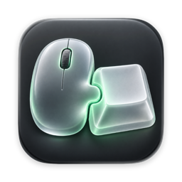
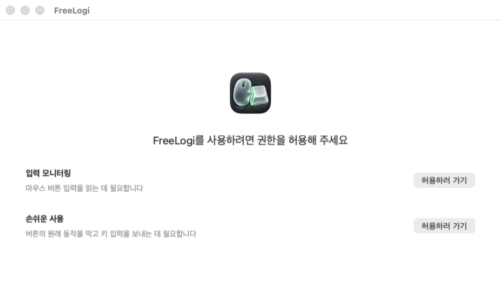
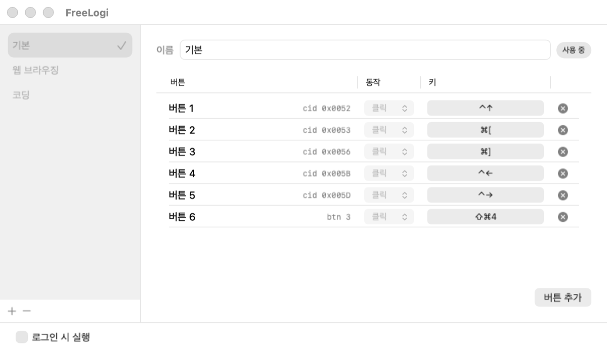
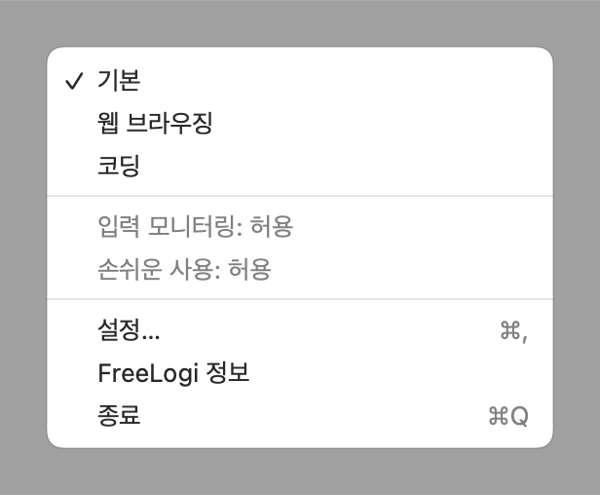
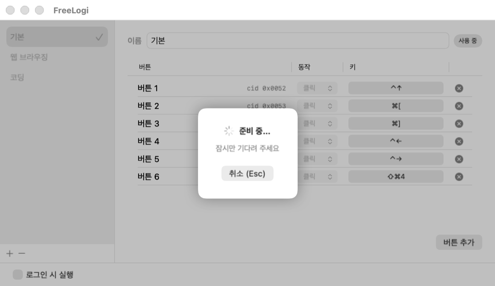
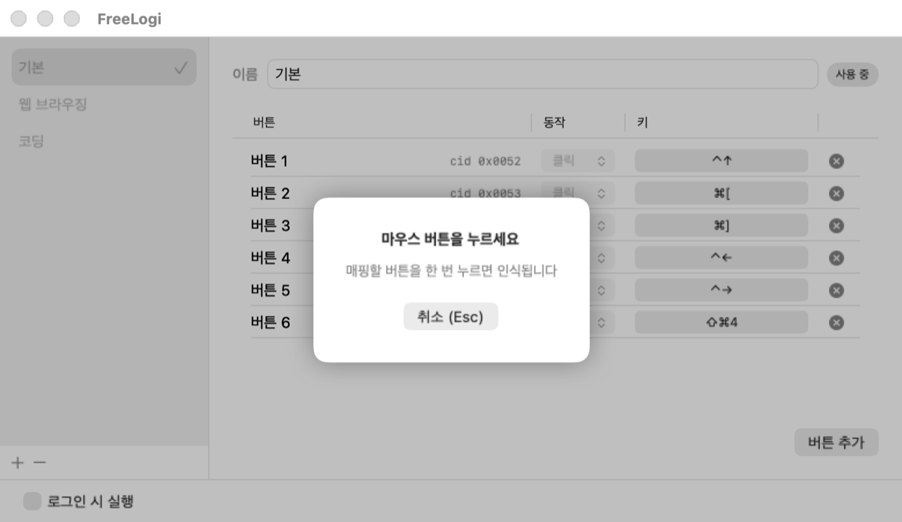

<p align="center"></p>

<h1 align="center">FreeLogi</h1>

<p align="center">macOS에서 로지텍 마우스 버튼에 키보드 단축키를 지정합니다.</p>

<p align="center">
  <a href="https://github.com/devlasbe/free-logi/releases/latest/download/FreeLogi.dmg"><b>FreeLogi.dmg 다운로드</b></a><br>
  macOS 13+ · Apple Silicon·Intel
</p>

<p align="center"><a href="README.md">English</a> | 한국어</p>

앱 UI는 macOS 언어에 따라 한국어 또는 영어로 나옵니다.

## 만든 이유

Logi Options+는 메모리를 과하게 쓰고, 툭하면 오류가 나서 마우스 버튼 매핑이 먹통이 되곤 했습니다.

OpenLogi는 미리 정해 둔 컨트롤 ID 목록으로 버튼을 찾기 때문에, 목록과 다른 ID를 쓰는 버튼(예: M720·Lift·MX Anywhere 2S의 제스처 버튼)이 잡히지 않는다는 보고가 있습니다([#1681](https://github.com/AprilNEA/OpenLogi/issues/1681), [#1199](https://github.com/AprilNEA/OpenLogi/issues/1199), [#1471](https://github.com/AprilNEA/OpenLogi/issues/1471)). FreeLogi는 정해진 목록 없이, 누른 버튼을 그대로 인식해 매핑합니다.

FreeLogi의 메모리는 제작자 Mac에서 설정 창을 열기 전 유휴 상태로 약 12MB(`phys_footprint`)였습니다. 설정 창을 연 뒤 측정값은 26MB였습니다(2026-10-18).

## 사용 설명서

### 설치

받은 DMG를 엽니다. FreeLogi를 Applications로 끌어다 놓고, Applications에서 실행합니다.

### 권한 허용

처음 실행하면 각 권한의 `허용하러 가기`를 누릅니다. **시스템 설정 → 개인정보 보호 및 보안 → 입력 모니터링**과 **손쉬운 사용**에서 FreeLogi를 켭니다. 입력 모니터링은 버튼 입력을 읽는 데, 손쉬운 사용은 원래 동작을 막고 키 입력을 보내는 데 필요합니다.

입력 모니터링을 새로 허용한 것이 감지되면 앱이 다시 실행됩니다. 두 권한을 모두 허용하면 매핑 화면으로 넘어갑니다.



### 프로필 만들기·바꾸기

왼쪽 아래 `+`를 누릅니다. `이름`에 프로필 이름을 입력하고 Return을 누릅니다. 왼쪽 목록에서 프로필을 고르면 바로 적용됩니다. 체크 표시와 `사용 중`으로 활성 프로필을 확인할 수 있습니다.

메뉴바에서도 프로필을 바꿀 수 있습니다. 프로필과 매핑은 자동으로 저장됩니다.
메뉴바의 “FreeLogi 정보”에서 앱 버전·제작자·GitHub 링크를 볼 수 있습니다.





### 버튼 추가

`버튼 추가`를 누릅니다. `준비 중…`이 보이는 동안 기다립니다.



`마우스 버튼을 누르세요`가 나오면 매핑할 버튼을 한 번 누릅니다. Esc를 누르면 취소합니다.



### 버튼 이름 바꾸기

추가한 버튼은 `버튼 1`처럼 번호로 표시됩니다. `버튼` 열에서 이름을 바꾸고 Return을 누릅니다. 이름 옆에는 원래 버튼 번호나 컨트롤 ID가 계속 표시됩니다.

### 키 지정

버튼이 인식되면 ⌘C처럼 지정할 단축키를 누릅니다. 나중에 바꾸려면 `키` 열의 해당 칸을 누르고 새 단축키를 입력합니다. Esc를 누르면 녹화를 취소합니다.

키 하나와 ⌘·⌥·⌃·⇧ 조합을 지정할 수 있습니다. 매핑한 버튼을 누르면 원래 동작 대신 현재 앱으로 단축키를 보냅니다.

### 방향 제스처 설정

HID++ 이동량 전송을 지원하는 버튼은 `동작` 열에서 방향을 고르고 단축키를 지정할 수 있습니다. 마우스 버튼을 누른 채 위·아래·왼쪽·오른쪽으로 움직인 뒤 놓습니다.

다른 방향도 지정하려면 같은 버튼을 다시 추가하고 아직 쓰지 않은 방향을 고릅니다. 이동량 전송을 지원하지 않는 버튼은 방향 선택이 비활성화됩니다.

### 로그인 시 실행

설정 창 아래의 `로그인 시 실행`을 켭니다.

### 매핑·프로필 지우기

행 오른쪽 `×`를 누르면 해당 매핑이 지워집니다. 프로필과 그 안의 매핑을 지우려면 프로필을 고르고 왼쪽 아래 `−`를 누른 뒤 확인합니다. 마지막 프로필 하나는 지울 수 없습니다.

## 개발

### 빌드

macOS에서 Xcode 또는 Swift 6+ 도구 모음을 사용합니다.

```sh
scripts/build-app.sh
swift test
```

앱 번들은 `build/FreeLogi.app`에 생성됩니다. 사용 가능한 Developer ID 또는 Apple Development 인증서로 서명합니다. `SIGN_IDENTITY`로 인증서를 지정할 수 있습니다. 인증서가 없으면 ad-hoc 서명을 쓰며, 재빌드할 때마다 개인정보 보호 권한을 다시 허용해야 합니다.

DMG를 만들려면 `uv`를 설치하고 `scripts/make-dmg.sh`를 실행합니다. 처음에는 dmgbuild를 내려받습니다. DMG 배경은 `swift scripts/draw-dmg-background.swift`로 다시 만듭니다.

### 릴리즈

관리자는 Developer ID Application 인증서, `gh`, 이름이 `freelogi`인 notarytool 키체인 프로필이 필요합니다. `xcrun notarytool store-credentials freelogi`로 프로필을 만듭니다.

변경 사항이 없는 `main` 브랜치에서 `scripts/release.sh [patch|minor|major|X.Y.Z]`를 실행합니다. Universal DMG를 빌드·서명·공증한 뒤, 확인을 받아 커밋·태그·푸시·GitHub 릴리즈 생성을 진행합니다.

### 디버그 플래그

`build/FreeLogi.app/Contents/MacOS/FreeLogi` 뒤에 아래 플래그를 붙입니다. 터미널에서 직접 실행하면 터미널의 개인정보 보호 권한을 사용합니다.

| 플래그 | 용도 |
| --- | --- |
| `--permissions` | 권한 상태 출력. |
| `--dump` | 로지텍 기기와 HID++ 컨트롤 목록 출력. |
| `--hid-access` | HID++ 기기 접근 확인. |
| `--capture [seconds]` | 다음에 인식한 버튼 출력. 기본 제한 시간 10초. |
| `--undivert` | 비정상 종료 뒤 가로채고 있던 버튼 복구. |
| `--snapshot <directory>` | 예제 설정·인식 안내·권한 화면과 메뉴 미리보기를 PNG로 저장. |
| `--inject <keyCode> <flags> [durationMs]` | 키 누르기·떼기 전송. 기본 누르는 시간 50ms. |

README 링크는 `scripts/check-readme-links.sh`로 확인합니다(Python 3 필요).

### 권한

| 권한 | 용도 |
| --- | --- |
| 입력 모니터링 | 마우스 버튼 입력을 읽고 Bluetooth LE HID++ 인터페이스 열기. |
| 손쉬운 사용 | 매핑한 버튼의 원래 동작을 막고 키보드 이벤트 보내기. |

## 참고한 프로젝트

HID++ 프로토콜과 권한 처리는 [OpenLogi](https://github.com/AprilNEA/OpenLogi)(MIT / Apache-2.0)와 [Solaar](https://github.com/pwr-Solaar/Solaar)를 참고했습니다.

## 라이선스

[MIT](LICENSE)
