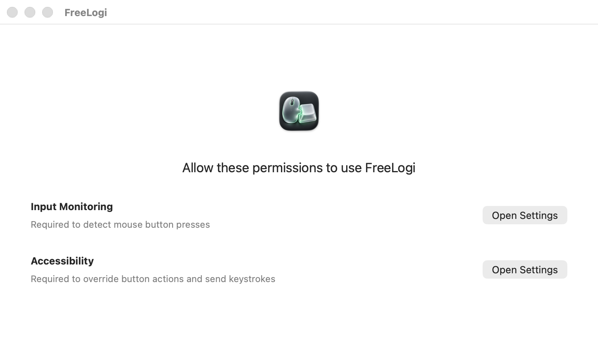
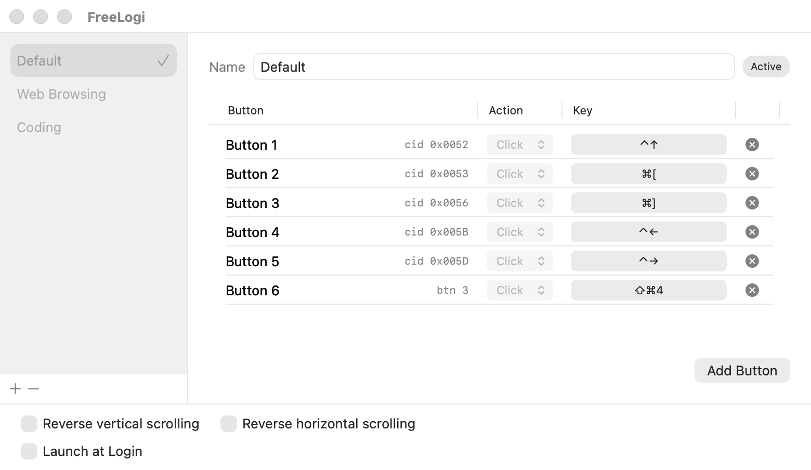
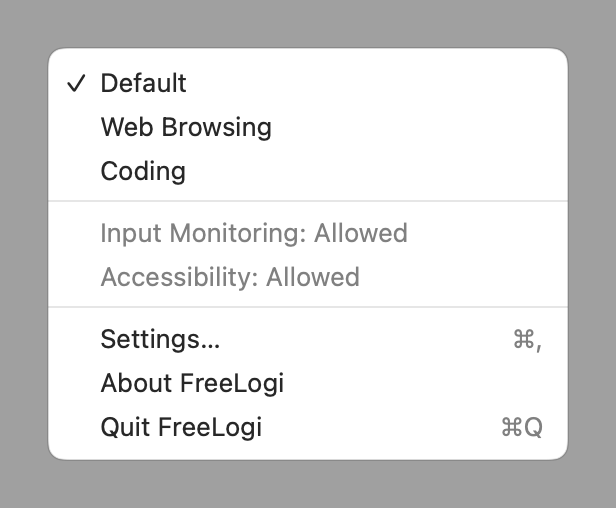
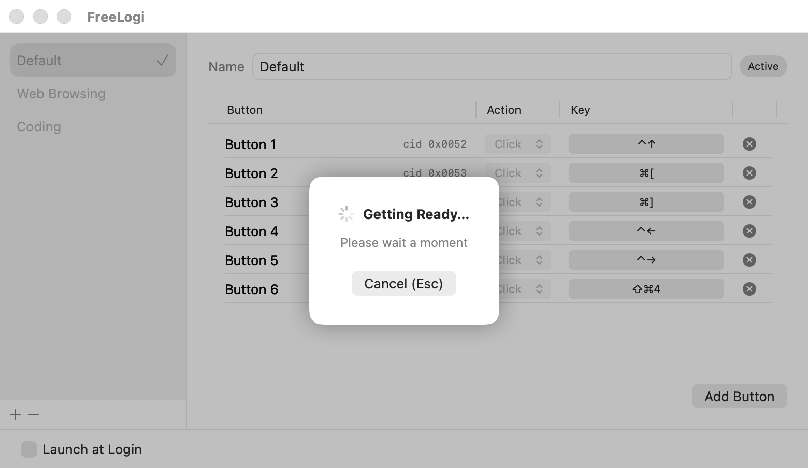
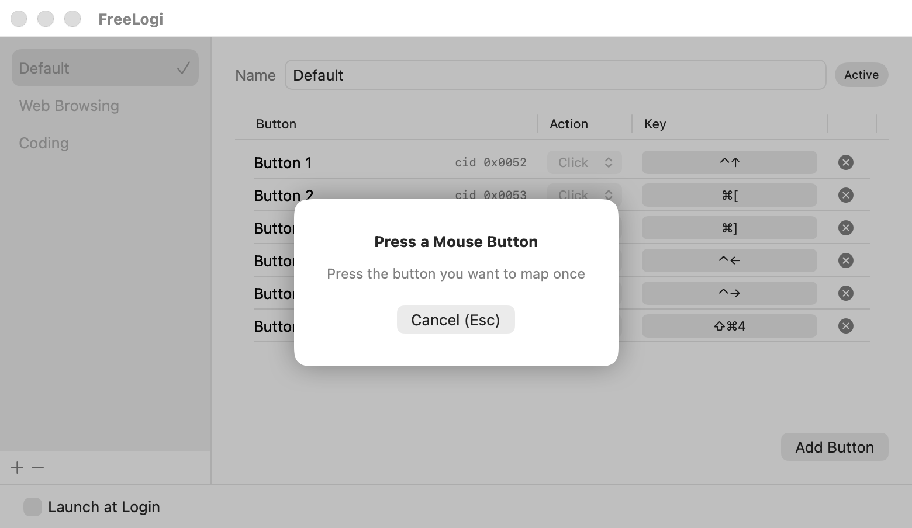

<p align="center"></p>

<h1 align="center">FreeLogi</h1>

<p align="center">Map Logitech mouse buttons to keyboard shortcuts on macOS.</p>

<p align="center">
  <a href="https://github.com/devlasbe/free-logi/releases/latest/download/FreeLogi.dmg"><b>Download FreeLogi.dmg</b></a><br>
  macOS 13+ · Apple Silicon and Intel
</p>

<p align="center">English | <a href="README.ko.md">한국어</a></p>

The app UI follows your macOS language: English or Korean.

## Why FreeLogi

Logi Options+ uses a lot of memory, and in my use it often hit errors that left mouse button mappings dead until it was restarted.

OpenLogi locates buttons through a predefined list of control IDs, and there are open reports of buttons with other IDs going uncaptured — e.g. the gesture buttons on the M720, Lift and MX Anywhere 2S ([#1681](https://github.com/AprilNEA/OpenLogi/issues/1681), [#1199](https://github.com/AprilNEA/OpenLogi/issues/1199), [#1471](https://github.com/AprilNEA/OpenLogi/issues/1471)). FreeLogi has no such list: it captures whichever button you press and maps it.

FreeLogi measured about 12 MB of memory (`phys_footprint`) while idle before opening the settings window on the author's Mac. After opening settings, the measurement was 26 MB (2026-10-18).

## User guide

### Install

Open the downloaded DMG. Drag FreeLogi to Applications, then open it from there.

### Grant permissions

On the first launch, select `Open Settings` for each permission. Enable FreeLogi in **System Settings → Privacy & Security → Input Monitoring** and **Accessibility**. Input Monitoring lets the app read button presses. Accessibility lets it replace the original action with keyboard input.

The app restarts when it detects newly granted Input Monitoring access. Once both permissions are enabled, the mapping screen appears.



### Create and switch profiles

Click `+` at the bottom left. Enter a profile name in `Name`, then press Return. Selecting a profile in the sidebar activates it. The checkmark and `Active` label show which profile is in use.

You can also switch profiles from the menu bar. Profiles and mappings are saved automatically.
Choose “About FreeLogi” from the menu bar to see the app version, author and GitHub link.





### Add a button

Click `Add Button`. Wait while `Getting Ready…` is shown.



When `Press a Mouse Button` appears, press the button you want to map once. Press Esc to cancel.



### Rename a button

New buttons receive numbered names, such as `Button 1`. Edit the name in the `Button` column and press Return. The raw button number or control ID stays visible next to the name.

### Assign keys

After a button is recognized, press the shortcut you want to assign, such as ⌘C. To change it later, click its cell in the `Key` column and press a new shortcut. Press Esc to cancel recording.

Mappings support a key with ⌘, ⌥, ⌃ and ⇧ modifiers. Pressing the mapped button sends that shortcut to the active app in place of its original action.

### Set directional gestures

For a button that supports HID++ raw movement, choose a direction in the `Action` column and assign a shortcut. Hold the mouse button, move the mouse up, down, left or right, then release it.

To map another direction, add the same button again and choose an unused direction. The direction selector is disabled for buttons without raw movement support.

### Reverse scrolling

Enable `Reverse vertical scrolling` or `Reverse horizontal scrolling` at the bottom of the settings window. Only mouse wheel scrolling is reversed; trackpad scrolling stays as macOS sets it. The setting applies to every profile.

### Launch at login

Enable `Launch at Login` at the bottom of the settings window.

### Delete mappings and profiles

Click `×` at the right of a row to delete that mapping. To delete a profile and its mappings, select it, click `−` below the sidebar, then confirm. The last remaining profile cannot be deleted.

## Development

### Build

Use Xcode or a Swift 6+ toolchain on macOS.

```sh
scripts/build-app.sh
swift test
```

The app bundle is written to `build/FreeLogi.app`. The build uses a Developer ID or Apple Development identity if available. Set `SIGN_IDENTITY` to choose one. Without an identity, it uses ad-hoc signing; privacy permissions must be granted again after each rebuild.

To build a DMG, install `uv` and run `scripts/make-dmg.sh`. It fetches dmgbuild on first use. Regenerate the DMG background with `swift scripts/draw-dmg-background.swift`.

### Release

Maintainers need a Developer ID Application certificate, `gh`, and a notarytool keychain profile named `freelogi`. Create the profile with `xcrun notarytool store-credentials freelogi`.

Run `scripts/release.sh [patch|minor|major|X.Y.Z]` from a clean `main` branch. It builds a universal DMG, signs and notarizes it, then asks for confirmation before committing, tagging, pushing and creating the GitHub release.

### Debug flags

Run `build/FreeLogi.app/Contents/MacOS/FreeLogi` with a flag below. Direct terminal execution uses the terminal's privacy permissions.

| Flag | Purpose |
| --- | --- |
| `--permissions` | Print permission status. |
| `--dump` | List Logitech devices and HID++ controls. |
| `--hid-access` | Check HID++ device access. |
| `--capture [seconds]` | Print the next captured button; default timeout is 10 seconds. |
| `--undivert` | Restore diverted buttons after an unexpected termination. |
| `--snapshot <directory>` | Render sample settings, capture prompts, permissions and a menu preview to PNG files. |
| `--inject <keyCode> <flags> [durationMs]` | Send a key press and release; default duration is 50 ms. |

Check README links with `scripts/check-readme-links.sh` (requires Python 3).

### Permissions

| Permission | Use |
| --- | --- |
| Input Monitoring | Read mouse button events and open Bluetooth LE HID++ interfaces. |
| Accessibility | Suppress mapped buttons' original actions and send keyboard events. |

## Acknowledgements

HID++ protocol and permission handling were informed by [OpenLogi](https://github.com/AprilNEA/OpenLogi) (MIT / Apache-2.0) and [Solaar](https://github.com/pwr-Solaar/Solaar).

## License

[MIT](LICENSE)
